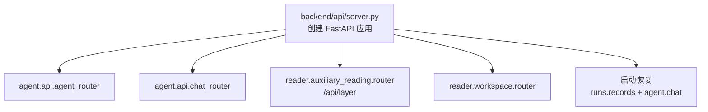
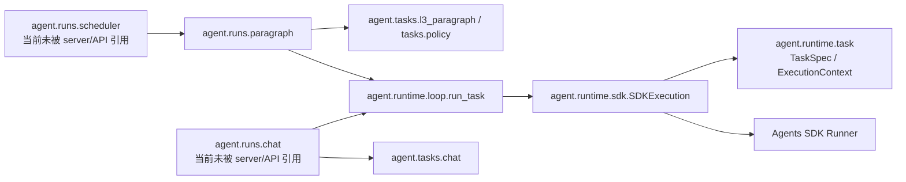

# Agent 文件与执行关系

更新核对：2026-10-18。本文按当前 `backend/api/server.py` 的导入和调用关系整理；“当前入口”指服务启动后实际接入的代码，不代表其他文件已经删除或没有用途。

## 先记住这四层

| 层 | 负责什么 | 主要文件 |
|---|---|---|
| HTTP 接口 | 接收前端请求、读写会话/任务 API、返回 JSON 或 SSE | `api.py`、`chat.py` |
| Run 调度 | 创建一条后台任务、遍历它包含的子任务、处理取消和收尾 | `runs/loop.py`、`runs/records.py` |
| Agent 执行 | 将任务、提示词、工具交给 Agents SDK；限制请求/工具预算 | 当前路径：`runtime/engine.py`；另一条未接入口的路径：`runtime/{task,sdk,loop}.py` |
| 书籍能力 | 取原文、组装上下文、提供阅读/概念工具和技能说明 | `tools/`、`skills/` |

`api.py` 是 HTTP 入口，不是模型执行主循环。`runs/loop.py` 是当前后台 run 的调度循环；单个模型任务的请求、工具和 SDK 事件由 `runtime/engine.py` 中的 `AgentTask` 执行。聊天目前走 `chat.py` 自己的 SDK 流程。

## 当前服务入口



`/api/layer/*` 是阅读器既有的层内容读取、手动保存和删除接口；它不是下面 `/api/agent/.../runs` 的后台生成调度器。它与 Agent 共用每本书的数据库和书籍工具。

## 当前实际执行链

### L3 段落任务

```mermaid
flowchart TD
    FE[frontend/static/js/workspace/] --> API[POST /api/agent/{book_id}/runs]
    API --> ROUTE[agent.api.create_run]
    ROUTE --> SCHED[agent.runs.loop.create_run]
    SCHED --> PREP[agent.layers.l3_paragraph.prepare_run<br/>校验范围、建立 run/task 记录]
    SCHED --> BG[asyncio.create_task(_run_worker)]
    BG --> OUTER[遍历 run 中的段落 task<br/>受并发信号量限制]
    OUTER --> PARA[agent.layers.l3_paragraph.ParagraphRun.run]
    PARA --> ENGINE[agent.runtime.engine.AgentTask.run]
    ENGINE --> SDK[OpenAI Agents SDK Runner]
    ENGINE --> TOOLS[agent.tools.reading<br/>读原文、检索、核验引用等]
    TOOLS --> BOOK[agent.tools.book<br/>书籍数据库与段落读取]
    PARA --> RECORDS[agent.runs.records<br/>保存候选稿、复核、事件和状态]
    RECORDS --> DB[(该书的 book.db)]
```

一次 L3 run 可以包含多个段落 task。`runs.loop._run_worker` 是外层循环：取出 task、逐个标记运行、拿并发许可，然后调用 `ParagraphRun.run()`。段落本身再按“生成 → 复核 → 必要时修订 → 保存/待核”推进。`AgentTask` 负责一次模型任务的 SDK 运行，不负责遍历整条 run 的段落列表。

### L1 / L2 / L4 长任务

`POST /api/agent/{book_id}/runs` 在 body 的 `layer` 不是 `L3` 时走另一分支：

```text
agent.api.create_run
  → agent.runs.loop.create_layer_run
  → asyncio.create_task(_layer_worker)
  → agent.runs.layer.LayerRun.run
  → agent.layers.l1_book / l2_chapter / l4_concept
  → agent.runtime.engine.AgentTask
  → agent.tools.* 与 Agents SDK
  → agent.runs.records / layer_results / layer_drafts
```

L4 创建任务前还会调用 `layers.l4_selection.gate` 清理/校验选中的术语。`LayerRun` 组织长任务的生成和独立复核，并决定自动发布还是保留为待核稿。

### 聊天

```mermaid
flowchart TD
    FE[workspace/] --> API[POST /api/chat/{book_id}/sessions/{session_id}/messages]
    API --> START[agent.api.send]
    START --> CREATE[agent.chat.start_message<br/>校验、写入 user/assistant 消息]
    CREATE --> BG[asyncio.create_task(agent.chat.answer)]
    BG --> CHAT[Runner.run_streamed + ChatHooks<br/>实际调用位于 agent.chat]
    CHAT --> TOOL[agent.tools.reading.chat_reading_tools]
    TOOL --> BOOK[agent.tools.book / tools.context]
    CHAT --> EVENTS[写 chat_messages / chat_events]
    EVENTS --> DB[(该书的 book.db)]
    FE -. 按游标读取 .-> SSE[GET .../messages/{message_id}/events]
```

聊天现在没有经过 `runs.loop` 或 `runtime.loop`。`agent.api` 负责会话和消息 HTTP 路由；`agent.chat` 负责后台回答、取消信号、SDK 会话、增量文本和事件记录。

## Run 与 Loop 的区别

| 名称 | 所在文件 | 当前作用 |
|---|---|---|
| Run | 数据库中的一条工作记录 | 表示一批工作及其状态；L3 run 可含多个段落 task，L1/L2/L4 run 通常对应一个层任务 |
| 外层调度循环 | `runs/loop.py::_run_worker` | 当前入口实际使用；遍历一条 L3 run 的段落 task、处理并发、取消和终态 |
| 单次 Agent 执行 | `runtime/engine.py::AgentTask.run` | 当前层任务使用；驱动 SDK、工具调用、预算和提交结果 |
| 新执行循环 | `runtime/loop.py::run_task` | 可执行单个 `TaskSpec` 的另一套通用循环，目前没有从 `server.py` / `agent.api` 接入 |

因此“主循环”要看指哪一层：run 的任务调度在 `runs/loop.py`；模型反复请求/调用工具由 Agents SDK 在 `AgentTask.run()` 内推进。聊天则由 `agent.chat.answer()` 直接启动流式 Runner。

## 另一套尚未接入 HTTP 入口的实现

代码里同时存在更通用的任务对象执行路径：



静态检查当前入口的导入链，没有发现 `server.py` 或 `agent.api` 调用 `runs.scheduler`、`runs.paragraph`、`runs.chat` 的路径。因此这组文件目前是并存的替代实现，不能与上面的运行链混画。`runs.scheduler` 的层任务分支仍会调用旧的 `runs.layer.LayerRun`，所以它也不是完全统一的新调度器。

`runtime/engine.py` 与 `runtime/{task,sdk,loop}.py` 还各自定义了任务/预算/SDK 适配功能。它们不是同一套类的两个文件：旧的活动路径导入 `engine.TaskSpec`、`engine.AgentTask`；新路径导入 `runtime.task.TaskSpec`、再由 `runtime.sdk.SDKExecution` 和 `runtime.loop.run_task` 执行。类名相近但类型不同。

## 数据放在哪里

| 数据 | 存储位置 | 主要读写者 |
|---|---|---|
| Agent 模型设置 | 全局设置 SQLite，由 `db.paths.SETTINGS_DB` 定位 | `runtime/config.py`、设置 API |
| 每本书的 run/task/事件/段落解释 | 对应书目录中的 `book.db` | `runs/records.py`、`tools/book.py`、`api.py` |
| 长层任务候选稿和复核结果 | 每本书的 `book.db`：`layer_results`、`layer_drafts` | `runs/layer.py`、`runs/records.py` |
| 聊天消息、事件和 SDK 历史 | 每本书的 `book.db`：`chat_sessions`、`chat_messages`、`chat_events`；SDK 历史单独存表 | `agent/chat.py`；另一套 `runs/chat.py` 尚未接入口 |

`backend/db/schema.py` 定义书籍数据库中的 Agent 主表。配置数据库和每本书的数据库用途不同：前者保存全局设置，后者保存该书的阅读与 Agent 状态。

## 文件目录与职责

### `backend/agent/` 根目录

| 文件 | 功能 | 当前入口状态 |
|---|---|---|
| `__init__.py` | 包说明 | 包初始化 |
| `api.py` | 注册 run 与 chat 路由；处理请求校验、查询、取消、重试、采纳和 SSE | **当前入口**；HTTP 层还直接做了部分 SQL/状态处理 |
| `chat.py` | 当前聊天实现：会话、回答任务、SDK hooks、流式事件、重启恢复 | **当前聊天执行实现** |
| `ARCHITECTURE.md` | 本文件：执行关系和依赖地图 | 文档 |

### `backend/agent/runs/`

| 文件 | 功能 | 当前入口状态 |
|---|---|---|
| `__init__.py` | 包说明 | 包初始化 |
| `loop.py` | 创建、调度、取消 run；L3 段落外层循环和 L1/L2/L4 worker | **当前入口** |
| `layer.py` | `LayerRun`：执行 L1/L2/L4 的生成、复核、保存或留待核稿 | **当前入口** |
| `records.py` | run/task/event/note 的 SQLite 写入、状态变更、序列化、恢复和采纳 | **当前入口** |
| `paragraph.py` | 用新 `TaskSpec`/`runtime.loop` 执行段落生成、复核、修订和持久化 | 替代路径；当前 API 未调用 |
| `chat.py` | 用新任务对象执行聊天、持久化流式结果 | 替代路径；当前 API 未调用 |
| `scheduler.py` | 面向 `runs.paragraph` 的另一套 worker/scheduler | 替代路径；当前 API 未调用 |

### `backend/agent/runtime/`

| 文件 | 功能 | 当前入口状态 |
|---|---|---|
| `__init__.py` | 包说明 | 包初始化 |
| `config.py` | `AgentConfig`、设置项定义、校验、读取和保存全局数据库设置 | **当前入口** |
| `engine.py` | 活动执行引擎：预算/错误类型、旧版任务规格、模型客户端、`AgentTask` 和 SDK hooks | **当前入口** |
| `task.py` | 新任务对象、工具/技能/提交规格、共享预算和执行上下文 | 替代执行路径 |
| `sdk.py` | 新路径的 SDK Agent/工具装配、hooks、流事件适配 | 替代执行路径 |
| `loop.py` | 执行一个新 `TaskSpec`；负责取消、预算和 SDK 生命周期 | 替代执行路径 |

### `backend/agent/layers/`（当前层任务定义）

| 文件 | 功能 | 当前入口状态 |
|---|---|---|
| `__init__.py` | 层任务包说明 | 包初始化 |
| `l0_index.py` | 无模型的书内术语/词项扫描与 L0 索引构建 | 当前 `tools.reading` 会用到 |
| `l1_book.py` | L1 全书覆盖与摘要生成 | `runs.layer` 调用 |
| `l2_chapter.py` | L2 章节材料组装、结构校验、结果格式与生成 | `runs.layer` 调用 |
| `l3_paragraph.py` | L3 段落 `ParagraphRun`；生成、独立复核、修订及段落 run 准备 | **当前入口** |
| `l4_concept.py` | L4 概念建图/定位的生成与校验 | `runs.layer` 调用 |
| `l4_selection.py` | 划词输入门禁：纠正或拒绝术语候选 | 当前 `runs.loop` 创建 L4 run 时调用 |
| `policy.py` | 旧执行路径共用的结果/复核规范、Markdown 渲染和校验 | **当前入口** |

### `backend/agent/tasks/`（新任务对象路径的领域定义）

| 文件 | 功能 | 当前入口状态 |
|---|---|---|
| `__init__.py` | 对话及 L0–L4 任务定义包说明 | 包初始化 |
| `chat.py` | 构造只读聊天的 `TaskSpec`、提示词和工具 | 仅 `runs.chat` 使用，未接入口 |
| `l0_index.py` | L0 术语扫描/索引逻辑的另一份实现 | 当前 Agent 入口未发现调用 |
| `l1_book.py` | L1 全书覆盖与摘要逻辑的另一份实现 | 当前 Agent 入口未发现调用 |
| `l2_chapter.py` | L2 章节任务定义和生成逻辑的另一份实现 | 当前 Agent 入口未发现调用 |
| `l3_paragraph.py` | L3 生成/复核/修订的任务规格和验证规则 | `runs.paragraph` 使用，未接入口 |
| `l4_concept.py` | L4 概念任务的另一份实现 | 当前 Agent 入口未发现调用 |
| `l4_selection.py` | 划词输入门禁的另一份实现 | 仅未接入口的 `runs.scheduler` 调用 |
| `policy.py` | 新任务定义路径的输出/复核规则与指令组装 | `runs.paragraph` 使用，未接入口 |

`layers/` 和 `tasks/` 不能简单理解为“旧目录”和“完整新目录”两套已切换实现：多组文件内容相近，但并非逐字相同；部分 `tasks` 文件仍含旧式 `generate(run)` 入口。当前 HTTP 调用明确进入 `layers/`。读代码或改动时要检查实际 import，不能只凭目录名判断是否生效。

### `backend/agent/tools/` 与 `skills/`

| 文件/目录 | 功能 | 主要使用方 |
|---|---|---|
| `tools/__init__.py` | 工具包说明 | 包初始化 |
| `tools/book.py` | 每本书的数据库入口、段落读取/定位、指纹、已有解释和基线检查 | layers、runs、chat、其他 tools |
| `tools/context.py` | 从目录/标题结构构造章节大纲、范围和材料引用 | L1/L2/L3、聊天 |
| `tools/reading.py` | 组装 `read_*`、检索、引用核验等通用书籍工具和技能 | 当前 layers/chat；概念工具复用其 handler |
| `tools/concept.py` | L4 概念建图/定位所需技能和专用工具 | L4 概念层 |
| `skills/book-reading/SKILL.md` | 书籍阅读工具使用规则 | 由 reading 工具加载 |
| `skills/concept-mapping/SKILL.md` | 概念建图规则 | 由概念工具加载 |
| `skills/concept-reading/SKILL.md` | 概念定位/阅读规则 | 由概念工具加载 |

## 直接模块依赖清单

以下列出 Agent 文件对仓库内 `agent.*`、`reader.*`、`db.*` 模块的直接 import（含函数内部的延迟 import）；Agents SDK、FastAPI、标准库等第三方/系统依赖省略。它补充上面的执行图，便于从任一文件反查。

| 文件 | 直接依赖 |
|---|---|
| `api.py` | `agent.chat`、`agent.runs.loop`、`agent.runs.records`、`agent.tools.book`、`reader.workspace` |
| `chat.py` | `agent.runtime.config`、`agent.runtime.engine`、`agent.tools.book`、`agent.tools.reading`、`reader.workspace` |
| `layers/l0_index.py` | `agent.runtime.config`、`agent.tools.book`、`reader.book_service` |
| `layers/l1_book.py` | `agent.layers.policy`、`agent.tools.book`、`agent.tools.context`、`reader.workspace` |
| `layers/l2_chapter.py` | `agent.layers.l0_index`、`agent.layers.l1_book`、`agent.runtime.engine`、`agent.tools.book`、`agent.tools.reading` |
| `layers/l3_paragraph.py` | `agent.layers.policy`、`agent.runs.records`、`agent.runtime.config`、`agent.runtime.engine`、`agent.tools.book`、`agent.tools.context`、`agent.tools.reading` |
| `layers/l4_concept.py` | `agent.runtime.engine`、`agent.tools.book`、`agent.tools.concept` |
| `layers/l4_selection.py` | 无 Agent 内部模块依赖 |
| `layers/policy.py` | `agent.runtime.config`、`agent.tools.book` |
| `runs/chat.py` | `agent.runtime.config`、`agent.runtime.loop`、`agent.runtime.sdk`、`agent.runtime.task`、`agent.tasks.chat`、`agent.tools.book`、`agent.tools.context`、`reader.workspace` |
| `runs/layer.py` | `agent.layers.l1_book`、`agent.layers.l2_chapter`、`agent.layers.l4_concept`、`agent.layers.policy`、`agent.runs.records`、`agent.runtime.config`、`agent.runtime.engine`、`agent.tools.book`、`agent.tools.reading`、`reader.workspace` |
| `runs/loop.py` | `agent.layers.l3_paragraph`、`agent.layers.l4_selection`、`agent.runs`、`agent.runs.layer`、`agent.runs.records`、`agent.runtime.config`、`agent.runtime.engine`、`agent.tools.book`、`reader.workspace` |
| `runs/paragraph.py` | `agent.runs.records`、`agent.runtime.config`、`agent.runtime.loop`、`agent.runtime.sdk`、`agent.runtime.task`、`agent.tasks.l3_paragraph`、`agent.tasks.policy`、`agent.tools.book`、`agent.tools.context`、`agent.tools.reading` |
| `runs/records.py` | `agent.layers.policy`、`agent.runtime.engine`、`agent.tools.book`、`reader.book_service`、`reader.workspace` |
| `runs/scheduler.py` | `agent.runs`、`agent.runs.layer`、`agent.runs.paragraph`、`agent.runtime.config`、`agent.runtime.task`、`agent.tasks.l4_selection`、`agent.tools.book`、`reader.workspace` |
| `runtime/config.py` | `db.paths`、`db.settings` |
| `runtime/engine.py` | 无 Agent 内部模块依赖；直接适配 Agents SDK / OpenAI 客户端 |
| `runtime/loop.py` | `agent.runtime.sdk`、`agent.runtime.task` |
| `runtime/sdk.py` | `agent.runtime.task` |
| `runtime/task.py` | 无 Agent 内部模块依赖 |
| `tasks/chat.py` | `agent.runtime.task`、`agent.tools.book`、`agent.tools.reading` |
| `tasks/l0_index.py` | `agent.runtime.config`、`agent.tools.book`、`reader.book_service` |
| `tasks/l1_book.py` | `agent.tasks.policy`、`agent.tools.book`、`agent.tools.context`、`reader.workspace` |
| `tasks/l2_chapter.py` | `agent.runtime.task`、`agent.tasks.l0_index`、`agent.tasks.l1_book`、`agent.tools.book`、`agent.tools.reading` |
| `tasks/l3_paragraph.py` | `agent.runtime.task`、`agent.tasks.policy`、`agent.tools.book`、`agent.tools.reading` |
| `tasks/l4_concept.py` | `agent.runtime.task`、`agent.tools.book`、`agent.tools.concept` |
| `tasks/l4_selection.py` | 无 Agent 内部模块依赖 |
| `tasks/policy.py` | `agent.runtime.config`、`agent.tools.book` |
| `tools/book.py` | `db.schema`、`reader.auxiliary_reading`、`reader.book_service` |
| `tools/concept.py` | `agent.runtime.engine`、`agent.tools.book`、`agent.tools.reading` |
| `tools/context.py` | `agent.tools.book`、`reader.book_service` |
| `tools/reading.py` | `agent.layers.l0_index`、`agent.runtime.engine`、`agent.tools.book`、`reader.book_service`、`reader.workspace` |

包目录下的 `__init__.py` 文件只提供包说明，没有额外业务依赖。

## 阅读顺序建议

想看“一次聊天怎么走”：`api.py` 的 `send` → `chat.py` 的 `start_message` → `chat.py` 的 `answer` → `tools/reading.py` → `tools/book.py`。

想看“一次段落 run 怎么走”：`api.py` 的 `create_run` → `runs/loop.py` → `layers/l3_paragraph.py` 的 `prepare_run` / `ParagraphRun.run` → `runtime/engine.py` 的 `AgentTask.run` → `tools/reading.py` → `runs/records.py`。

想看 L1/L2/L4：从 `api.py` 的 `create_run` 跟到 `runs/loop.py::create_layer_run`，再看 `runs/layer.py::LayerRun.run` 与对应 `layers/l*.py`。

想理解“新任务对象”路径：看 `runtime/task.py` → `runtime/sdk.py` → `runtime/loop.py`，然后追 `runs/paragraph.py` 或 `runs/chat.py`。记住这条路径目前没有被 HTTP 入口接上。
