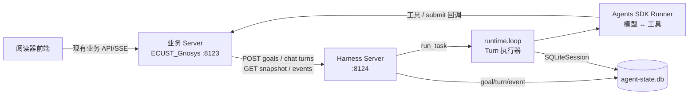
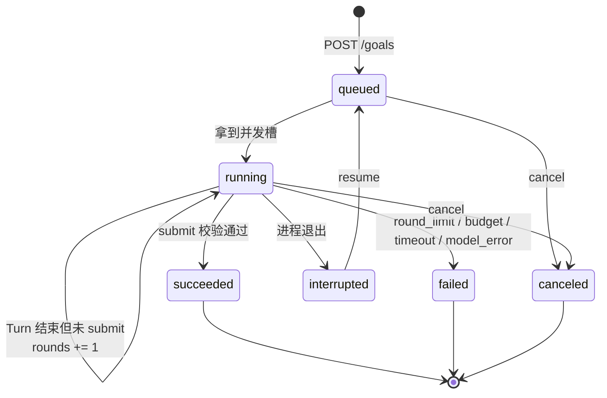
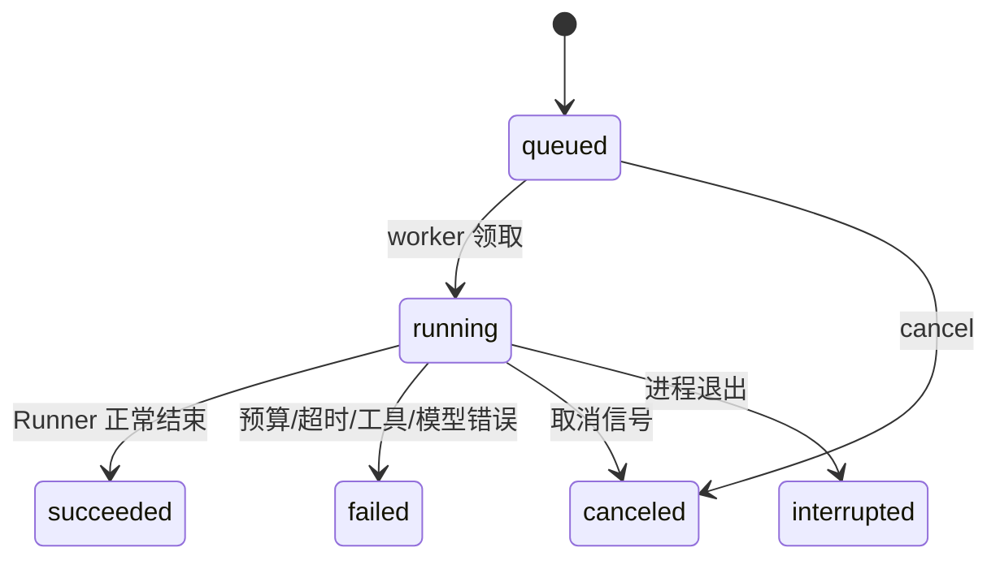

# Harness 核心设计

状态：设计稿 v1，2026-10-24。配套文档：[server.md](server.md)、[reader-integration.md](reader-integration.md)。

## 1. 目标与边界

Harness 解决三个现有实现没有统一的问题：

1. **多轮**：一次模型运行没完成时，谁来决定再跑一轮、带什么上下文、最多跑几轮。
2. **恢复**：进程重启、取消、超时后，Goal 到了哪一步、预算还剩多少、会话历史是否可信。
3. **出口**：业务 Server 如何提交任务、接收流式事件、取消和执行工具，而不把模型执行搬进业务进程。

边界：

- Harness 只认识 `Goal`、`Turn`、`Session`、`TaskSpec` 和回调契约，不认识书、章节、笔记。
- 业务审核、复核、待核稿、发布仍然是业务 Server 的职责。
- 模型选择、供应商差异由 `runtime/sdk.py` 的 `build_model`/`model_settings` 处理。
- 评测、打分、数据集管理不在本期。

## 2. 组件关系



关键点：**工具执行不在 Harness 进程**。Harness 只把工具描述挂给模型，模型调用时通过 HTTP 回调业务 Server，业务 Server 用现有 `tools/` 能力执行并返回结果。这样书库连接、权限和写入边界都不变。

## 3. 对象

### 3.1 Goal

```python
@dataclass
class Goal:
    id: str                    # 客户端给定，幂等键；建议 <run_id>:<stage>
    objective: str             # 目标，一句话
    instructions: str | None   # 业务提示词；为空时使用默认 Goal 指令
    acceptance: dict           # 机器可读的验收条件，原样交给模型与 submit 校验
    input: dict                # 业务输入引用（book_id、章节、段落范围等）
    context: dict              # 跨轮上下文，由 update_goal_context 写入
    status: GoalStatus         # queued/running/succeeded/failed/canceled/interrupted
    rounds: int                # 已执行的 Turn 数
    max_rounds: int
    budget: GoalBudget         # 跨轮共享：requests / tools / tokens / timeout
    submit: SubmitSpec         # 业务提供的交卷工具；必须 submit_ 前缀
    tools: list[ToolSpec]
    skills: list[SkillSpec]
    allowed_skills: list[str]
    session_key: str           # 默认 goal:<id>
    run_id: str                # 回调注册键，Goal 场景等于 id
    config: ModelConfig        # 模型连接信息；不落库，resume 时必须重新提供
```

`context` 只存模型主动保存的进度，不存业务原文。原文由工具按需读取。

`instructions/acceptance/input/tools/skills/submit` 这些静态定义整体存进 `goals.spec_json`，恢复时直接重建 `TaskSpec`；只有 `config`（含 API key）不落库。

### 3.2 Turn

```python
@dataclass
class Turn:
    id: str                    # 客户端给定（聊天）或服务端生成（Goal）
    goal_id: str | None        # Goal 的 Turn 非空；聊天 Turn 为空
    run_id: str                # 回调注册键：Goal 用 goal_id，聊天用 turn_id
    session_key: str           # goal:<goal_id> / chat:<业务会话键>
    round: int                 # Goal 内序号；聊天固定 1
    status: TurnStatus         # queued/running/succeeded/failed/canceled/interrupted
    submitted: bool            # 仅 Goal 有意义：submit 是否通过
    output: str | dict | None  # 最终文本或 submit 规范化结果
    usage: Usage
    session_cursor: int        # Turn 开始前 SDK messages 表的最大 id
```

一个 Turn = 一次 `run_task`。Turn 不负责唤醒下一个 Turn，这属于 Goal runner。

### 3.3 Session

- Goal：默认 `session_key = goal:<goal_id>`，所有轮共享，SDK 会话历史随轮次增长。
- 业务可以显式传入 `session_key`，让多个 Goal 共享一段会话：L3 的生成与修订传同一个 key，独立复核传另一个 key。共享会话的阶段必须串行，不能并发提交。
- 聊天：`session_key = chat:<业务键>`，每个业务会话一条。
- 会话表与业务表分开：状态库内 `harness_sessions` / `harness_items`，不与业务书籍库混用。
- 每个 Turn 开始前记录 `session_cursor = MAX(id)`；失败/取消时删除该会话 `id > session_cursor` 的条目，把会话恢复到上一个完成边界。

## 4. 状态机

### 4.1 Goal



`failed` 不自动恢复。业务要重试时用新的 `goal_id`，避免把一次失败的历史和新请求混在一起。

### 4.2 Turn



Turn 的 `succeeded` 只表示“这次执行正常结束”，不代表 Goal 完成；Goal 完成看 `submitted=true`。

## 5. Goal runner

### 5.1 循环

```python
async def run_goal(goal_id: str) -> None:
    goal = store.claim_goal(goal_id)              # queued -> running
    budget = store.restore_budget(goal)            # 跨轮共享
    session = open_session(goal.session_key)
    last_output = None
    try:
        while goal.rounds < goal.max_rounds:
            if cancelled(goal):                   # 排队/上一轮结束时也可能取消
                finish_goal(goal, "canceled")
                return

            turn = store.start_turn(goal)
            ctx = ExecutionContext(
                model=build_model(goal.config),
                config=goal.config,
                cancelled=cancel_event(goal.id),
                emit=make_emitter(goal, turn, budget),
                budget=budget,
                session=session,
                submitted=None,                    # 本轮新增字段
            )
            try:
                output = await asyncio.wait_for(
                    run_task(goal.task_spec(), ctx),
                    timeout=goal.turn_timeout_seconds,
                )
            except AgentCancelled:
                truncate_session(goal, turn.session_cursor)
                store.finish_turn(turn, "canceled")
                store.finish_goal(goal, "canceled")
                return
            except (BudgetExceeded, asyncio.TimeoutError) as exc:
                truncate_session(goal, turn.session_cursor)
                store.finish_turn(turn, "failed", code="budget_exceeded" if isinstance(exc, BudgetExceeded) else "timeout")
                store.finish_goal(goal, "failed", code=...)
                return
            except Exception as exc:
                truncate_session(goal, turn.session_cursor)
                store.finish_turn(turn, "failed", code="model_error")
                store.finish_goal(goal, "failed", code="model_error")
                return

            if ctx.submitted is not None:
                store.finish_turn(turn, "succeeded", submitted=True, output=ctx.submitted)
                store.finish_goal(goal, "succeeded", output=ctx.submitted)
                return

            # 没交卷：保留本轮会话历史，下一轮接着做。
            last_output = output
            store.finish_turn(turn, "succeeded", submitted=False, output=output)
            goal.rounds += 1
            store.save_goal_progress(goal, budget)
        store.finish_goal(goal, "failed", code="round_limit", output=last_output)
    finally:
        session.close()
        store.release(goal)
```

### 5.2 Turn 的输入

`TaskSpec` 在每一轮重新构造：

```python
TaskSpec(
    name=f"goal:{goal.id}",
    prompt=goal_prompt(goal),          # 见 5.3
    materials={"input": goal.input},
    submit=goal.submit,                # 只有它通过才算完成
    tools=[*goal.tools, update_context_tool(goal)],
    skills=goal.skills,
    allowed_skills=goal.allowed_skills,
    stream=True,
    tool_limit_action="fail",          # Goal 模式不允许卸掉 submit 后自由作答
    parallel_tool_calls=False,         # 每个模型回合最多一个工具（PRD 生命周期）
)
```

`ExecutionContext.budget` 已传入共享预算，`TaskSpec.budget` 不作为第二套真值。`parallel_tool_calls` 需要从 `TaskSpec` 透传到 `runtime/sdk.py::model_settings`；聊天 Turn 不设置，保留供应商默认。它是请求参数，供应商不支持时 SDK 会按返回顺序串行执行；无论哪种情况，每个工具都独立登记证据和预算。

### 5.3 Goal prompt

```
{业务 instructions，若为空则用默认}

Objective: {objective}
Acceptance: {acceptance JSON}
Input: {input JSON}
Context: {context JSON}
Round: {rounds + 1} / {max_rounds}

Use the available tools to gather evidence. Call update_goal_context to persist
progress that must survive to the next round. Do not call {submit.name} until
the acceptance conditions are met; it ends the goal.
```

约束：

- `acceptance` 与 `input` 每轮都完整重述，不依赖模型记住上一轮。
- `context` 上限 16 KiB；超过时 `update_goal_context` 返回错误，模型需要先压缩再写。
- 不把完整原文塞进 prompt；原文通过业务工具按需读取。

### 5.4 完成语义

| 情况 | Turn | Goal |
|---|---|---|
| `submit_*` 调用且 validator 返回 dict | `succeeded`, `submitted=true` | `succeeded`, `output=dict` |
| validator 抛错/返回非 dict | Turn 继续，模型可在本轮重试；重试次数由工具/请求预算约束，不另设计数器 | 不变 |
| 模型正常收尾但没有 submit | `succeeded`, `submitted=false` | 未完成；`rounds += 1` 继续 |
| 轮次用尽 | 最后一轮 `succeeded` | `failed`, `round_limit` |
| 预算/总时限耗尽 | `failed`, `budget_exceeded`/`timeout` | `failed` |
| 工具处理函数抛错（非 4xx 协议错误） | `failed`, 按异常来源记 `tool_error`/`model_error` | `failed` |
| 取消 | `canceled` | `canceled` |
| 进程退出 | `interrupted` | `interrupted` |

空输出且无 submit 也算未完成，按轮次继续；不额外做“无进展”判断，轮次和预算就是止损线。

`error.code` 统一为：`round_limit`、`budget_exceeded`、`timeout`、`tool_error`、`model_error`、`callback_error`、`internal`。取消和中断用状态表达，不重复写错误码。

### 5.5 需要给单轮执行器补的唯一字段

`SDKExecution._submit` 已经把结果存在实例上，但 `run_task` 只返回 `final_output`。Harness 需要区分“submit 的 dict”和“模型自由文本”，因此：

```python
@dataclass
class ExecutionContext:
    ...
    submitted: Any = None   # SDKExecution._submit 成功后写入

# runtime/sdk.py::_submit
self.context.submitted = submitted
```

不改 `run_task` 返回值，现有调用方不受影响。

## 6. Chat runner

聊天没有 Goal、没有 submit、没有跨轮 context：

```python
async def run_chat_turn(turn_id: str) -> None:
    turn = store.claim_turn(turn_id)
    session = open_session(turn.session_key)
    ctx = ExecutionContext(
        model=build_model(turn.config),
        config=turn.config,
        cancelled=cancel_event(turn.id),
        emit=make_emitter(None, turn, budget),
        budget=restore_budget(turn),
        session=session,
        submitted=None,
    )
    try:
        output = await asyncio.wait_for(run_task(turn.task_spec(), ctx), turn.timeout)
        store.finish_turn(turn, "succeeded", output=output or "")
    except AgentCancelled:
        truncate_session(turn, turn.session_cursor)
        store.finish_turn(turn, "canceled")
    except (BudgetExceeded, asyncio.TimeoutError):
        truncate_session(turn, turn.session_cursor)
        store.finish_turn(turn, "failed", code="budget_exceeded")
    except Exception:
        truncate_session(turn, turn.session_cursor)
        store.finish_turn(turn, "failed", code="model_error")
```

- 一个业务会话同时只能有一个 `queued|running` 的聊天 Turn；第二个请求返回 409。和 `chat.py` 当前的保护一致。
- `TaskSpec.submit=None`，`tool_limit_action="finish"`：工具预算用完时卸下工具，让模型基于已读材料作答。
- 聊天不保存 context 对象；SDK 会话历史就是上下文。业务如果需要在消息里保存引用、来源，由业务 Server 自己写业务事件。
- 最终文本以 `turns.output` 为准。业务适配层收到 `turn_finished` 后用快照覆盖前端消息，避免流式增量丢失导致文本不完整。

## 7. 上下文

### 7.1 写入

Goal 模式固定挂载一个 Harness 自有工具：

```json
{
  "name": "update_goal_context",
  "description": "保存需要跨轮保留的进度。只写关键结论、已覆盖范围、下一步，不要写原文。",
  "parameters": {
    "patch": {"type": "object", "description": "要合并进 Goal context 的键值"}
  },
  "required": ["patch"]
}
```

处理规则：

1. `patch` 必须是 JSON 对象，否则抛 `ValueError`，模型收到错误文本后可重试。
2. 与现有 `goal.context` 做顶层浅合并。
3. 合并后的 JSON UTF-8 字节数不得超过 16 KiB；超过则拒绝，不截断。
4. 成功即写入状态库并发出 `goal_context_updated` 事件，返回 `{"ok": true, "bytes": n}`。
5. 取消/失败不回滚已写入的 context：它是模型已经确认过的进度，下一轮仍可使用；会话历史则回滚到本轮开始前。

### 7.2 读取

- 每轮 prompt 注入完整 context。
- 快照接口默认不返回 context，只有 `?include=context` 才返回，避免把业务中间结果带进普通查询。
- 不做自动摘要、不做向量化。上下文超限由模型自己压缩，Harness 只负责拒绝超限写入。

## 8. 预算、时限与取消

### 8.1 预算

| 字段 | 默认 | 作用域 |
|---|---|---|
| `max_requests` | `config.max_requests`（默认 12，Goal 建议 24–48） | Goal 全部 Turn 共享 |
| `max_tool_calls` | `config.max_tool_calls`（默认 20） | Goal 全部 Turn 共享 |
| `max_tokens` | 200000 | Goal 全部 Turn 共享；输入 + 输出 |
| `timeout_seconds` | `config.run_timeout`（默认 300） | Goal 运行总时长，不含排队/停机 |
| `max_rounds` | 6 | Goal 轮次上限 |
| `turn_timeout_seconds` | 300 | 单轮上限，防止一次 provider 挂起吃掉全部预算 |

- 复用 `LoopBudget`：计数在 `on_llm_start` / 工具包装里推进，Goal 的每一轮传同一个实例。
- `LoopBudget` 增加 `max_tokens` 和 `check_tokens()`；`ExecutionHooks.on_llm_end` 在 `record_usage` 之后检查，超限抛 `BudgetExceeded`。Token 只能事后结算，所以最后一次模型调用可能小幅超出上限，超出的量以单次响应为界。
- `timeout_seconds` 只统计运行时长，不含排队和进程停机：`goals.elapsed_seconds` 每轮结束累加，每轮开始时把 `budget.deadline` 设为 `time.monotonic() + max(0, timeout_seconds - elapsed_seconds)`。
- 进程崩溃时按 `turn.started_at` 到启动时刻估算该 Turn 的时长，封顶 `turn_timeout_seconds` 后计入 `elapsed_seconds`；恢复后剩余时间不足则立即 `budget_exceeded`。
- 每轮结束把 `requests/tool_calls/input_tokens/output_tokens/total_tokens/elapsed_seconds` 写回 `goals` 行；`model_end`/`tool_end` 事件也顺手更新一次，进程崩溃最多丢最后一小段计数。
- Goal 模式固定 `tool_limit_action="fail"`：卸掉工具会连 submit 一起卸掉，模型无法交卷，只会得到一次必然失败的轮次。

### 8.2 取消

1. `POST /goals/{id}/cancel` 设置进程内 `asyncio.Event`，写入 `cancel_requested_at`。
2. 正在运行的 Turn 由 `run_task` 的取消竞速捕获，抛 `AgentCancelled`。
3. Goal runner 回滚本轮会话条目，写 `turn=canceled`、`goal=canceled`、`goal_finished` 事件。
4. 排队中的 Goal 直接标记 `canceled`，不创建 Turn。
5. 终态上的 cancel 幂等，返回 `requested=false`。
6. 取消与 submit 同时发生时，取消优先：提交成功后仍要检查取消信号，已取消则不记 `succeeded`。

### 8.3 超时

- Goal 总时限由 `LoopBudget.deadline` 执行，覆盖模型请求和工具调用之间的等待。
- 单轮超时用 `asyncio.wait_for`；超时后该 Turn `failed`，Goal `failed`，不自动重试。
- 工具回调自身超时（默认 60 秒）按工具错误处理：4xx/超时返回错误文本让模型换策略；连续触发仍受工具预算约束。

## 9. 工具与 submit 回调

### 9.1 契约

沿用 `protocol.py` 的 `ToolContract` / `SkillContract` / `SubmitContract`，新增两个载荷字段：

```json
{
  "call_id": "call_01J...",
  "turn_id": "t_01J...",
  "arguments": {"paragraph_index": 3}
}
```

- `call_id` 由 Harness 生成，用于业务侧幂等。
- `turn_id` 用于区分同一 Goal 的不同轮次。
- 工具名、参数 JSON Schema、必填项与现有 `ToolSpec` 完全一致。
- 工具参数和结果只存在于 Harness → 业务回调 → 模型这条链上；Harness 事件只带 `id/tool/status/error`。业务如果要把结果用于 UI（例如来源引用），在回调处理函数里自己写业务事件。

### 9.2 回调路由

按 `run_id` 注册，Goal 的 `run_id = goal_id`，聊天 Turn 的 `run_id = turn_id`：

```
POST {GNOSYS_SERVER_URL}/internal/v1/agent-runs/{run_id}/tools/{tool_name}
POST {GNOSYS_SERVER_URL}/internal/v1/agent-runs/{run_id}/submit
Authorization: Bearer {GNOSYS_AGENT_TOKEN}
```

现有 `/internal/v1/agent-executions/{execution_id}/...` 保留给旧 execution 路径；新 Harness 只走 `agent-runs`。

### 9.3 错误映射

| 业务回调结果 | Harness 行为 | 模型看到 |
|---|---|---|
| 200 + `{"result": ...}` | 工具成功 | 结果文本 |
| 4xx（工具参数/业务拒绝） | 工具错误，本轮继续 | `{"ok": false, "error": "..."}` |
| 5xx / 连接失败 / 超时 | 发 `tool_error` 事件，Turn `failed` | 无（本轮终止） |
| submit 422（validator 退回） | 转成 `ValueError` | `提交被退回：...`，模型可改后重试 |
| submit 5xx / 连接失败 | Turn `failed` | 无 |
| submit 返回非 dict | 视为退回 | `提交结果必须是对象` |

工具结果序列化后上限 256 KiB；超过按 4xx 工具错误处理，避免把整本书塞回 prompt。

### 9.4 业务侧要求

- 工具处理函数必须幂等或只读。恢复/重试可能让同一个 `call_id` 再次到达；业务应按 `(run_id, call_id)` 去重，或把写操作做成幂等。
- 跨 Turn 的重放不会复用 `call_id`：新 Turn 会生成新的调用。写工具必须按业务内容幂等（例如同一 `run_id` + 目标位置只写一次），或者干脆保持只读。
- submit validator 必须是纯校验：只返回规范化结果，不写业务表、不发布。业务写入和发布在收到 `goal_finished(succeeded)` 之后执行，这样响应丢失或重试不会产生半发布状态。
- 回调注册生命周期覆盖整个 Goal；Goal 终态后注销。进程重启后注册丢失，未完成 Goal 会因 404 失败，由业务显式恢复。
- 业务 Server 在提交 Goal 前注册，在 `goal_finished` 后注销；取消也要注销。

## 10. 持久化

状态库：`ECUST_Gnosys/database/agent-state.db`（`GNOSYS_AGENT_STATE_DB` 可覆盖），WAL，`busy_timeout=30000`。

```sql
CREATE TABLE goals (
    id TEXT PRIMARY KEY,
    request_hash TEXT NOT NULL,
    spec_json TEXT NOT NULL,          -- 静态任务定义；不含 config/api_key
    objective TEXT NOT NULL,          -- 列表/快照用，避免解 JSON
    context_json TEXT NOT NULL DEFAULT '{}',
    session_key TEXT NOT NULL,
    status TEXT NOT NULL,
    output_json TEXT,
    error_code TEXT,
    error_message TEXT,
    error_details_json TEXT,
    rounds INTEGER NOT NULL DEFAULT 0,
    max_rounds INTEGER NOT NULL,
    max_requests INTEGER NOT NULL,
    max_tool_calls INTEGER NOT NULL,
    max_tokens INTEGER NOT NULL,
    timeout_seconds REAL NOT NULL,
    turn_timeout_seconds REAL NOT NULL,
    requests INTEGER NOT NULL DEFAULT 0,
    tool_calls INTEGER NOT NULL DEFAULT 0,
    input_tokens INTEGER NOT NULL DEFAULT 0,
    output_tokens INTEGER NOT NULL DEFAULT 0,
    elapsed_seconds REAL NOT NULL DEFAULT 0,
    created_at TEXT NOT NULL,
    started_at TEXT,
    updated_at TEXT NOT NULL,
    finished_at TEXT
);

CREATE TABLE turns (
    id TEXT PRIMARY KEY,
    run_id TEXT NOT NULL,
    goal_id TEXT,
    session_key TEXT NOT NULL,
    round INTEGER NOT NULL DEFAULT 0,
    status TEXT NOT NULL,
    submitted INTEGER NOT NULL DEFAULT 0,
    output_json TEXT,
    error_code TEXT,
    error_message TEXT,
    requests INTEGER NOT NULL DEFAULT 0,
    tool_calls INTEGER NOT NULL DEFAULT 0,
    input_tokens INTEGER NOT NULL DEFAULT 0,
    output_tokens INTEGER NOT NULL DEFAULT 0,
    session_cursor INTEGER NOT NULL DEFAULT 0,
    created_at TEXT NOT NULL,
    started_at TEXT,
    finished_at TEXT
);

CREATE TABLE events (
    id INTEGER PRIMARY KEY AUTOINCREMENT,
    run_id TEXT NOT NULL,
    goal_id TEXT,
    turn_id TEXT,
    stage TEXT NOT NULL,
    message TEXT NOT NULL DEFAULT '',
    data_json TEXT,
    created_at TEXT NOT NULL
);

CREATE INDEX idx_goals_status ON goals(status, created_at);
CREATE INDEX idx_turns_goal ON turns(goal_id, round);
CREATE INDEX idx_turns_session ON turns(session_key, status);
CREATE INDEX idx_events_goal ON events(goal_id, id);
CREATE INDEX idx_events_turn ON events(turn_id, id);
```

SDK 会话表：`harness_sessions` / `harness_items`，与 `agent-state.db` 同库，但表名独立。

写入约定：

- 状态迁移和事件写入用短事务；不在事务里做网络调用。
- `text_delta` / `reasoning_delta` 按 Turn 缓冲，每 250 ms 或累计 4 KiB 合并成一条事件写入；写任何非 delta 事件（工具、提交、结束）前先 flush，保证文本顺序；Turn 结束时强制 flush。这样前端最多延迟 250 ms，SQLite 不会每条 token 写一次。
- 不持久化，也不写入 Harness 事件流：API key、模型请求体、工具参数、工具结果、完整 prompt。`events.data_json` 只保留定位所需的 id、工具名、状态、错误文本（截断 500 字）和用量；`runtime/sdk.py` 原始 `tool_start/tool_end` 里的 `args/result` 由 Harness 的 emitter 过滤掉。
- 不自动清理事件。需要保留期时后续加 `HARNESS_EVENT_RETENTION_DAYS`，本期不做。

## 11. 并发、恢复与幂等

### 11.1 并发

- 全局 `asyncio.Semaphore(HARNESS_MAX_PARALLEL)`，默认 2。
- 排队队列 FIFO；`HARNESS_MAX_QUEUE` 默认 100，超出返回 429。
- 同一 Goal 永远串行：一个 Turn 结束后才进入下一轮。
- 同一聊天会话串行：服务端检查 `turns` 表是否有该 `session_key` 的 `queued|running` 行，有则 409。
- 不同 Goal / 不同聊天会话可并行，上限由信号量控制。

### 11.2 重启恢复

启动时：

```sql
UPDATE turns SET status='interrupted'
 WHERE status IN ('queued','running');
UPDATE goals SET status='interrupted', updated_at=now()
 WHERE status IN ('queued','running');
```

- 只对原本 `running` 的 Turn（`started_at` 非空）按它的 `session_cursor` 删除该会话的后续条目，清掉半轮历史；原本 `queued` 的 Turn 没写过会话，`session_cursor=0`，不能拿来回滚。
- 只对原本 `running` 的 Turn 用 `started_at` 到启动时刻估算运行时长，封顶 `turn_timeout_seconds` 后累加到所属 Goal 的 `elapsed_seconds`。
- 聊天 Turn 同样在启动时回滚半轮历史；它没有 resume，下一轮由业务重新创建。
- 不自动续跑：`config`（含 API key）不落库，进程重启后没有模型凭据；自动恢复会失败或被迫持久化密钥。
- `POST /goals/{id}/resume` 只接受 `interrupted`，请求体重新提供 `config`；服务端从 `goals.spec_json` 重建 `TaskSpec`，保留 `rounds`、预算用量、`elapsed_seconds`、context 和 `session_key`，创建新的 Turn。
- 恢复时把该 Goal 的会话回滚到最后一个已完成 Turn 的边界：删除该会话 `harness_items.id > MAX(turns.session_cursor WHERE status='succeeded')` 的条目。若没有可用游标，清空该 Goal 的会话，依靠 Goal prompt + context 重建。
- 恢复前业务必须重新注册 `run_id` 的回调处理函数；注册表只存在进程内，重启后为空。
- 部署变更后如果工具语义已变，不要 resume 旧 Goal；取消后用新的 `goal_id` 重新提交。
- 优雅退出：停止接收新请求，给运行中的 Turn 发取消信号，最多等 10 秒，再标记 `interrupted`。

### 11.3 幂等

- `goal_id` + 规范化请求哈希：重复提交且哈希一致返回现有记录；不一致返回 409。
- 哈希计算时把 `config.api_key` 置空，避免密钥进哈希/日志。
- `turn_id` 同理。
- cancel/resume 幂等；resume 对非 `interrupted` 返回 409。
- 回调幂等由业务按 `(run_id, call_id)` 负责。

## 12. 与 `agent/` 原型和现有实现的差异

| 原型/现有 | Harness 设计 |
|---|---|
| `agent/loop.py` 每轮结束无条件 `complete_goal` | 只有 `ctx.submitted` 非空才 `succeeded` |
| context 从 `AgentResult.context_updates` 隐式更新 | 显式 `update_goal_context` 工具，可失败、可审计 |
| Goal 只存在于进程内 + CLI 打印 | Goal/Turn/事件持久化 + HTTP/SSE |
| `service.py` 一次请求只跑一轮 | Goal 跨多轮，预算和会话共享 |
| `chat.py` 自己构造 Runner | 聊天 Turn 复用同一个 `run_task` |
| 预算只有请求/工具/时限 | 增加共享 `max_tokens`，模型返回后结算 |
| 供应商默认允许并行工具 | Goal 模式 `parallel_tool_calls=False`，每轮最多一个工具 |
| 每个 Goal 固定独立会话 | 允许业务传 `session_key` 复用会话（L3 生成/修订） |
| 无单轮上限 | `turn_timeout_seconds` |
| 无恢复策略 | 启动标记 interrupted + 显式 resume + 会话游标回滚 |
| 事件逐条写库 | 生命周期逐条；文本增量合并 |

## 13. 明确不做

- Goal 嵌套 / 子 Goal：业务需要拆任务时创建多个 Goal，由业务编排。
- 自动重试失败的 Turn：模型客户端内部的 `max_retries` 仍生效，但 Harness 不做业务级重试。
- 上下文向量检索、自动摘要、长期记忆。
- 多租户、分布式 worker、跨机器队列。
- 工具沙箱、代码执行、浏览器工具。
- 评测集与自动打分。
