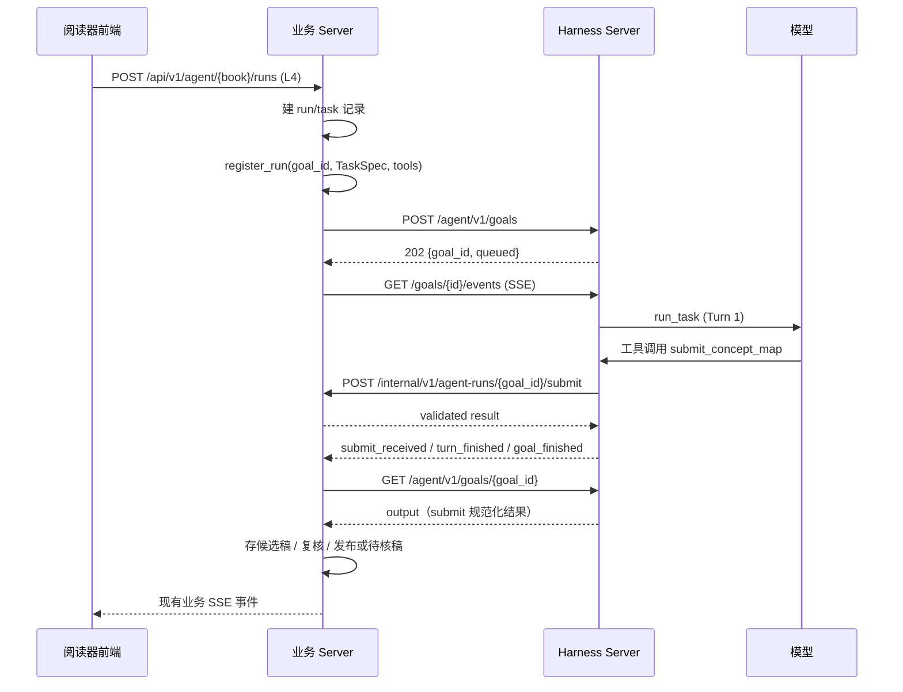
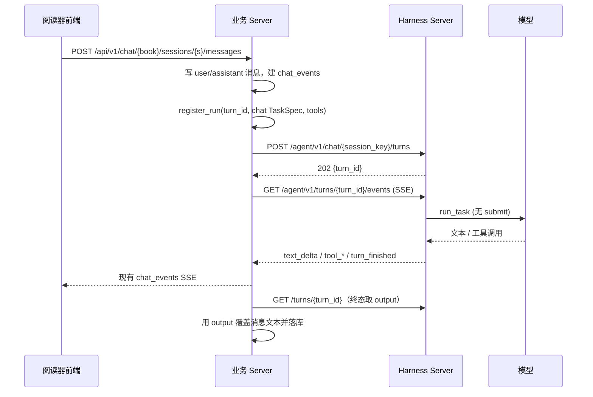

# 与 ECUST_Gnosys 的接线

状态：设计稿 v1，2026-10-24。Harness 语义见 [harness.md](harness.md)，服务契约见 [server.md](server.md)。

## 1. 原则：业务编排留在业务 Server

Harness 只替换**一次模型执行的入口**，不接管业务编排：

- L3 的“生成 → 复核 → 修订 → 再复核”仍由 `layers/l3_paragraph.py::ParagraphRun.run` 编排。
- L1/L2/L4 的候选稿、复核、发布仍由 `runs/layer.py::LayerRun.run` 编排。
- run/task、待核稿、笔记、事件表仍由 `runs/records.py` 和业务 Server 管理。
- Harness 的 Goal 多轮唤醒只用于确实需要模型自己迭代的任务；不需要迭代的阶段用 `max_rounds=1`。

这样不会把业务状态机复制进 Harness，也不会因为迁移改变发布语义。

## 2. 映射

| 业务对象 | Harness 资源 | `goal_id` / `turn_id` | `session_key` | 轮次 |
|---|---|---|---|---|
| L3 段落生成 | Goal | `<run_id>:<task_id>:generate` | `l3:<run_id>:<task_id>:draft` | 1 |
| L3 复核 | Goal | `<run_id>:<task_id>:review` | `l3:<run_id>:<task_id>:review` | 1 |
| L3 修订 | Goal | `<run_id>:<task_id>:revise` | `l3:<run_id>:<task_id>:draft` | 1 |
| L3 修订后复核 | Goal | `<run_id>:<task_id>:review2` | `l3:<run_id>:<task_id>:review` | 1 |
| L1 全书覆盖 | Goal | `<run_id>:l1` | 默认 `goal:<goal_id>` | 2–8；context 记覆盖范围 |
| L2 章节点 | Goal | `<run_id>:<node_id>` | 默认 | 1–2 |
| L4 意义地图 | Goal | `<run_id>:map` | 默认 | 1–3 |
| L4 位置解释 | Goal | `<run_id>:locate` | 默认 | 1–2 |
| 聊天一条回复 | Chat Turn | `<assistant_message_id>` | `chat:<book_id>:<session_id>` | 1 |

ID 约定：

- Goal 的 `run_id` 就等于 `goal_id`，业务按它注册工具回调，跨 Turn 稳定。
- Chat Turn 的 `run_id` 就等于 `turn_id`。
- 所有 ID 都由业务生成，Harness 不重新编号；重试时业务生成新的 `goal_id`，避免历史混淆。
- **L3 生成和修订共用 `draft` 会话，两次复核共用 `review` 会话**，对应 PRD 的“生成与修订复用同一会话、独立校验使用单独会话”。同一个 session key 的阶段必须串行；并行提交会让历史交错。
- 共享会话的 Goal 失败时，只按自己的 `session_cursor` 回滚本轮条目，不会删除前一个 Goal 已写入的历史。
- L1/L2/L4 的修订如果希望模型直接记住上一稿，也可以共享 `draft` 会话；不共享时把上一稿作为 `input`/materials 传入，效果等价但 prompt 更长。默认只为 L3 启用共享，避免无意中把不同阶段的历史混在一起。

状态映射：

| Harness | 业务 run/task | 说明 |
|---|---|---|
| `queued` / `running` | `running` | 前端只看到业务状态 |
| `succeeded` | `completed` 或 `needs_review` | 是否发布仍由业务校验/复核决定 |
| `failed` | `failed` | 保留 `error_code` 供前端区分预算、轮次、模型错误 |
| `canceled` | `canceled` | 用户取消 |
| `interrupted` | `interrupted` | 进程退出；业务决定重新提交还是 resume |

### 2.1 证据索引

PRD 的“任务级原文证据索引”留在业务 Server：

- `read_*` 工具的回调处理函数把返回的原文按 `(chapter_idx, paragraph_index)` 登记到本次 `run_id` 的 ledger；工具返回的指纹一并保存。
- `submit_*` validator 用 ledger + 原文 + 指纹校验引文；Harness 不解析原文，也不知道证据是否充分。
- Harness 只保证工具调用顺序和 `run_id/turn_id/call_id` 可追踪；Goal 模式每轮最多一个工具，ledger 的登记顺序与事件顺序一致。
- 原文和工具结果不进入 Harness 状态库或事件流；需要复现时，业务用 ledger、候选稿、校验结果和 Harness 的用量/事件记录联合还原。

### 2.2 模型分配与预算

- 每个阶段单独提交 Goal，`config` 按阶段选择模型：L0 术语提名等低成本环节用小模型；L1–L4 生成和修订用能力更强的模型。
- 每个 Goal 的 `budget.max_requests`、`max_tool_calls`、`max_tokens`、`timeout_seconds`、`max_rounds` 独立声明；Token 预算跨该 Goal 的所有 Turn 共享。
- L3 生成和修订是两个 Goal，但共用 `draft` 会话；预算分别计算，业务可以在修订阶段收紧 `max_requests`。
- Token 预算在每次模型返回后结算；超限时该 Turn 以 `budget_exceeded` 失败，业务可在任务面板显示“预算耗尽”而不是模型错误。

## 3. L4 Goal 时序

要点：

- 前端不直连 Harness；业务 Server 消费 Harness SSE 后写入 `agent_run_events`，浏览器仍用现有 `/api/v1/agent/.../events`。
- Harness 的 `text_delta` 由业务适配层转成业务事件；最终文本以 Turn 快照为准。
- 业务侧注册的回调在 Goal 终态后注销。

## 4. 聊天时序

要点：

- 业务 Server 不再自己构造 `Runner`、`SQLiteSession`、`ChatHooks`；`chat.py` 只保留消息、引用、取消、重试、导出和事件持久化。
- 聊天工具的参数、结果和来源引用都由业务回调处理函数直接提取并写 `chat_events`（现有 trace/sources 展示不变）；Harness 事件只提供工具名和状态，不回传参数或结果。
- `session_key = chat:<book_id>:<session_id>`，业务删除会话时调用 `DELETE /agent/v1/sessions/...`。
- 同一会话已有运行中的回复时，业务层保持现有 409 行为；Harness 也会返回 409，形成双保险。

## 5. 业务侧需要改的文件

| 文件 | 改造 |
|---|---|
| `backend/agent/remote.py` | 新增 `run_goal(...)`、`run_chat_turn(...)`：构造契约、注册回调、提交、消费 SSE、取快照、注销。现有 `execute_agent` 保留给未迁移路径 |
| `backend/api/agent_bridge.py` | 新增 `/internal/v1/agent-runs/{run_id}/tools/{name}` 与 `/submit`；注册表键从 `execution_id` 扩展为 `run_id`；回调载荷增加 `call_id`、`turn_id` |
| `backend/agent/chat.py` | `answer()` 改为调用 `run_chat_turn`，删除 `Agent`/`Runner`/`SQLiteSession`/`ChatHooks` 和本地预算；消息状态机、事件、来源、取消、恢复保持 |
| `backend/agent/runs/loop.py` | L3 的每个阶段调用 `run_goal`，`max_rounds=1`；外层遍历、并发、取消、终态不变 |
| `backend/agent/runs/layer.py` | L1/L2/L4 的 `execute()` 调用 `run_goal`；复核/修订编排不变 |
| `backend/agent/runs/records.py` | 不需要新表；`goal_id` 只进事件 `data_json`，需要查询时按 run/task 反推 |
| `backend/agent/runtime/task.py` | `ExecutionContext` 增加 `submitted` |
| `backend/agent/runtime/sdk.py` | `_submit` 写入 `context.submitted` |
| `backend/agent/service.py` | 挂载 Harness 路由；旧 execution 逻辑保留 |
| `backend/api/server.py` | 不变；浏览器 API 不变 |
| `frontend/*` | 不变 |

可选：给 `agent_run_tasks` 加 `remote_goal_id` 列做调试索引。默认不加，避免迁移；ID 可由 `run_id/task_id/stage` 直接构造。

## 6. 迁移阶段

每个阶段都必须能以环境变量回退，避免一次性切换。

### 阶段 0：契约与测试骨架

- 落地本文档和 [server.md](server.md) 的 JSON 契约。
- 新增 `tests/test_harness_store.py`（纯状态库）和 `tests/test_harness_server.py`（FastAPI + 确定性 fake model）。
- 不改业务代码。

验收：测试可独立运行，不打开 `database/books/` 真实书库。

### 阶段 1：Harness 核心

- `backend/agent/harness/{models,store,runner}.py`。
- `ExecutionContext.submitted` 与 `SDKExecution._submit` 接线。
- `run_goal` / `run_chat_turn` 在进程内可调用；进程内模式没有队列和幂等，只用于调试。

验收：

- fake model 下 Goal 成功、未交卷、轮次用尽、取消、预算耗尽、恢复。
- 会话游标回滚测试：失败 Turn 后 `harness_items` 回到 Turn 前。
- 现有 `tests/test_agent_service.py` 仍通过。

### 阶段 2：HTTP 路由

- `harness/routes.py` 挂到 `service.py`。
- 旧 `/agent/v1/executions` 不动。
- 增加幂等、冲突、SSE 重放、队列上限、认证测试。

验收：

- curl 脚本可完成“创建 Goal → SSE → 快照 → 取消 → resume”；resume 重新提交 `config` 并重新注册回调。
- 同 `goal_id` 重放不产生第二次执行。
- 状态库中没有 API key。

### 阶段 3：聊天迁移

- `chat.py::answer` 改为 Harness 客户端。
- 环境变量 `GNOSYS_HARNESS_CHAT=0` 可回退旧实现，默认先 0，验收后改 1。
- 保留 `chat_events`、消息状态、取消、重试、导出行为。

验收：

- 现有聊天浏览器 e2e 全通过（390/1024/1440 视口）。
- 取消/重试/待核稿采纳行为不变。
- 同一会话并发发送仍返回 409。

### 阶段 4：L4 与 L1/L2

- `LayerRun.execute` 改用 `run_goal`。
- L4 的 matcher/validator 不变。
- 对比 fake model 下的候选稿、复核结果、发布/待核稿状态与旧路径一致。

验收：

- `tests/test_agent_service.py` 的四层覆盖用例全通过。
- `tests/test_workspace.py` 的复核/修订/待核稿用例全通过。
- 真书抽一章对比输出结构与证据位置。

### 阶段 5：L3 阶段迁移

- `ParagraphRun` 的每次 `_execute` 改走单轮 Goal。
- 外层 generate/review/revise 编排不变。

验收：

- 段落解释、复核、修订、待核稿、取消、失败重试的现有用例全通过。
- 浏览器端段落解释与任务事件无回归。

### 阶段 6：清理

- `chat.py` 删除自己的 SDK 执行链。
- `service.py` 的旧 execution 路由标记为兼容层；没有调用方后再删除。
- 更新 `README.md`、`ARCHITECTURE.md`、`docs/api-v1.md` 与 OpenAPI。

验收：

- `uv run python tests/test_workspace.py`
- `uv run python tests/test_agent_service.py`
- `uv run python tests/browser_server.py` + `ego-browser nodejs < tests/browser_e2e.mjs`
- 全部通过后才切默认。

## 7. 验收用例

### 7.1 Harness 单元

| 用例 | 断言 |
|---|---|
| Goal 一次 submit | `succeeded`，`output` 等于 validator 结果，`rounds=1` |
| Goal 三轮后 submit | 前两轮 `submitted=false`，第三轮 `succeeded`，context 保留 |
| 从不 submit | `failed`，`code=round_limit`，最后一轮输出保留 |
| 预算耗尽 | `failed`，`code=budget_exceeded`，不再发起模型请求 |
| Token 预算 | 模型返回后累计 token 超限 → `budget_exceeded`；`goals.usage.total_tokens` 落库 |
| 每轮一工具 | Goal 模式的 `ModelSettings.parallel_tool_calls=False` 传给 SDK；单轮最多一个工具 |
| 取消运行中 | `canceled`，会话回滚到 Turn 前，`requested=true` |
| 取消排队中 | `canceled`，不产生 Turn |
| 进程重启 | 运行中记录变 `interrupted`；resume 后从下一个 Turn 继续 |
| context 超限 | 工具返回错误文本，Goal 不中断；模型可压缩后重试 |
| 会话游标 | 失败 Turn 后 SDK items 数量回到 Turn 开始前 |
| 事件合并 | 连续 delta 合并为一条，turn 结束强制 flush |

### 7.2 Server 接口

| 用例 | 断言 |
|---|---|
| 无令牌 | 401；未配置令牌 503 |
| 幂等创建 | 同 ID 同哈希返回 `reused=true`，只执行一次 |
| 冲突创建 | 同 ID 不同哈希 409 |
| 会话忙 | 第二个聊天 Turn 409 `session_busy` |
| SSE 重放 | `after` 和 `Last-Event-ID` 都能续读，终态发 `end` |
| 取消/恢复 | 状态与事件一致，恢复不接受非 interrupted |
| 队列满 | 429 `queue_full` |
| 密钥 | 状态库、快照、事件、日志都不含 `api_key` |

### 7.3 业务集成

| 用例 | 断言 |
|---|---|
| 工具回调 | `run_id` 注册、`call_id` 透传、4xx 回模型、5xx 终止 |
| submit 退回 | 422 后模型重试，最终通过或轮次用尽 |
| 工具重复 | 同一 `(run_id, call_id)` 只产生一次业务写入 |
| 证据索引 | `read_*` 回调登记 ledger；submit validator 用 ledger 校验；Harness 事件和状态库不含原文 |
| L3 会话 | 生成与修订共享 `draft` 会话，复核使用独立 `review` 会话；共享阶段串行 |
| L4 | 候选稿/复核/发布与旧路径一致 |
| L3 | 生成/复核/修订/待核稿一致 |
| 聊天 | 文本、引用、取消、重试、导出一致 |
| 浏览器 | 三视口 e2e 与现有验收记录一致 |

## 8. 风险与处理

| 风险 | 处理 |
|---|---|
| 工具回调重复导致重复写库 | 业务按 `(run_id, call_id)` 幂等；新写操作必须带唯一键 |
| 取消/失败后的会话回滚不彻底 | 以 `turns.session_cursor` 为准；没有游标时清空该 Goal 会话，靠 context 重建 |
| SQLite 写放大 | WAL；delta 合并；事件只存元数据；单 Turn 单连接 |
| 长 Goal 事件过多 | 保留期后续再加；本期按 Goal 查询，不提供全表导出 |
| 模型/provider 差异 | 复用 `build_model`/`model_settings`；禁用 thinking 时继续 `tool_choice=required` |
| 提示注入 | 业务工具只读且限定 book_id；不挂文件系统/任意 HTTP 工具 |
| 迁移行为漂移 | 阶段开关 + fake model 对照 + 真书抽章对比 |
| 重启后无人续跑 | 默认不自动 resume；业务在启动恢复流程里决定是否重新提交 |
| 回调注册丢失 | 业务启动时扫描未终态 run/task，重新注册；resume 时重新提供模型 `config`（密钥不落库）；否则 Goal 会以 404 或 422 失败 |
| Goal 成功但业务未发布 | 业务启动恢复时按 `goal_id` 查询 `succeeded` 且本地未落库的记录，用 `goals.output` 补做校验/发布；发布逻辑本身必须幂等 |

## 9. 已选默认值

这些选择可以直接改，不阻塞实现：

1. **L3 每个阶段一个单轮 Goal**，不把复核/修订编排塞进 Goal。
2. **Goal ID = 业务 run/task/stage 拼接**，不改业务表结构。
3. **文本增量 250 ms 合并**，业务终态用快照覆盖。
4. **不自动 resume**，由业务决定是否重新消耗模型预算。
5. **回调按 `run_id` 注册**，Goal 跨 Turn 不再注册；聊天按 Turn 注册。
