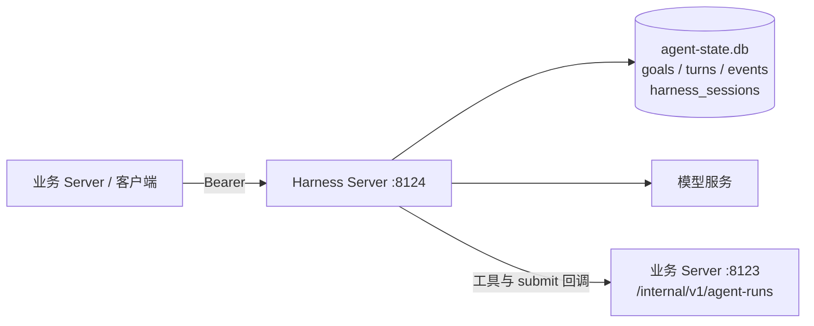

# Harness Server 契约

状态：设计稿 v1，2026-10-24。核心语义见 [harness.md](harness.md)。

## 1. 服务形态

Harness Server 是现有 Agent Service 的扩展，不新建进程和端口：

| 项 | 值 |
|---|---|
| 进程入口 | `ECUST_Gnosys/agent_service.py` |
| 框架 | FastAPI + uvicorn |
| 默认地址 | `127.0.0.1:8124`（`GNOSYS_AGENT_HOST` / `GNOSYS_AGENT_PORT`） |
| 状态库 | `database/agent-state.db`（`GNOSYS_AGENT_STATE_DB`） |
| 认证 | `Authorization: Bearer <GNOSYS_AGENT_TOKEN>` |
| 上游 | OpenAI 兼容 Chat Completions |
| 下游 | 业务 Server 的 `/internal/v1/agent-runs/...` 回调 |
| 并发 | 进程内 `asyncio.Semaphore`，单机 SQLite |

`dev.py` 仍按现有方式先起 Agent Service，再起业务 Server；`server.py` 的进程内模式（`GNOSYS_AGENT_MODE=local`）复用同一组 runner 函数，不走 HTTP。进程内模式没有队列、幂等键和 SSE 重放，只适合单进程调试和离线测试；验收以 HTTP 模式为准。



## 2. 公共约定

### 2.1 认证

- 所有 `/agent/v1/*` 与内部回调都要求 Bearer 令牌。
- `GNOSYS_AGENT_TOKEN` 未配置时返回 503 `token_not_configured`，不降级为无认证。
- 比较使用 `hmac.compare_digest`。
- 令牌只来自环境变量，不接受请求体传入。

### 2.2 错误格式

沿用项目 API v1 的错误包：

```json
{
  "error": {
    "code": "goal_conflict",
    "message": "goal_id 已用于不同请求",
    "details": {}
  }
}
```

| code | HTTP | 场景 |
|---|---|---|
| `invalid_request` | 422 | 字段缺失、长度/范围/JSON Schema 不合法 |
| `unauthorized` | 401 | 令牌缺失或不匹配 |
| `token_not_configured` | 503 | 服务端未配置令牌 |
| `not_found` | 404 | goal/turn/session 不存在 |
| `goal_conflict` | 409 | 同 `goal_id` 但请求哈希不同 |
| `turn_conflict` | 409 | 同 `turn_id` 但请求哈希不同 |
| `session_busy` | 409 | 同一聊天会话已有 queued/running Turn |
| `goal_not_resumable` | 409 | 只有 `interrupted` 可 resume |
| `queue_full` | 429 | 排队超过 `HARNESS_MAX_QUEUE` |
| `callback_denied` | 422 | `callback_url` 不在允许前缀 |
| `internal` | 500 | 未归一化异常；消息截断，不返回密钥 |

### 2.3 SSE

所有事件流使用与现有 execution 一致的信封：

```text
id: 41
event: update
data: {"id":41,"run_id":"g-1","goal_id":"g-1","turn_id":"t-1","stage":"tool_start","message":"执行工具：read_paragraph","data":{"id":1,"tool":"read_paragraph","status":"running"},"at":"2026-10-24T12:00:00+08:00"}

event: end
data: {}
```

- 支持 `?after=<id>` 和 `Last-Event-ID`，取两者较大值。
- 轮询间隔 0.5 秒；连接存活时发送 `: keep-alive` 注释。
- 终态后先发完剩余事件，再发 `end`。
- 已结束的资源立即返回历史事件和 `end`，不悬挂连接。

### 2.4 事件阶段

| stage | 持久化 | 说明 |
|---|---|---|
| `goal_queued` | 是 | 创建成功 |
| `turn_started` | 是 | 包含 round |
| `model_start` / `model_end` | 是 | 请求序号、token 累计 |
| `tool_start` / `tool_end` / `tool_error` | 是 | 只存 id、工具名、状态、错误；参数和结果不进入事件流 |
| `goal_context_updated` | 是 | 键列表与字节数 |
| `submit_received` | 是 | 只存结果键名 |
| `text_delta` / `reasoning_delta` | 是（合并） | 250 ms 或 4 KiB 合并一条；仅 Goal 和聊天共用 |
| `turn_finished` | 是 | 状态、用量 |
| `goal_finished` | 是 | 终态、轮次 |
| `end` | 否 | 流结束 |

工具参数和结果不经过 Harness 事件流：它们由业务回调处理函数直接消费，需要展示时由业务自己写业务事件。Harness 事件只负责模型文本、工具状态和生命周期；最终内容以 `turns.output` / `goals.output` 快照为准。

## 3. 路由总表

| 方法 | 路径 | 作用 |
|---|---|---|
| `GET` | `/health` | 就绪、版本、active/queued 数 |
| `POST` | `/agent/v1/goals` | 创建 Goal |
| `GET` | `/agent/v1/goals` | 列表（`status`、`limit`、`before`） |
| `GET` | `/agent/v1/goals/{goal_id}` | Goal 快照 |
| `POST` | `/agent/v1/goals/{goal_id}/cancel` | 取消 |
| `POST` | `/agent/v1/goals/{goal_id}/resume` | 恢复 `interrupted` |
| `GET` | `/agent/v1/goals/{goal_id}/events` | Goal 事件流（含所有 Turn） |
| `POST` | `/agent/v1/chat/{session_key}/turns` | 创建聊天 Turn |
| `GET` | `/agent/v1/turns/{turn_id}` | Turn 快照 |
| `POST` | `/agent/v1/turns/{turn_id}/cancel` | 取消聊天 Turn |
| `GET` | `/agent/v1/turns/{turn_id}/events` | Turn 事件流 |
| `DELETE` | `/agent/v1/sessions/{session_key}` | 清除 SDK 会话历史 |
| `POST` | `/agent/v1/executions` | 旧单轮接口，保留兼容 |
| `GET` | `/agent/v1/executions/{id}` | 旧快照，保留兼容 |
| `GET` | `/agent/v1/executions/{id}/events` | 旧事件流，保留兼容 |
| `POST` | `/agent/v1/executions/{id}/cancel` | 旧取消，保留兼容 |

## 4. Goal API

### 4.1 创建

`POST /agent/v1/goals`

```json
{
  "goal_id": "run-9f2c:paragraph-3:generate",
  "objective": "解释第二章第 3 段，并给出原文证据",
  "instructions": "你是阅读助手。解释必须严格基于原文。",
  "acceptance": {
    "must_quote": true,
    "max_chars": 1200
  },
  "input": {
    "book_id": "jing-shen-xian-xiang-xue",
    "chapter_idx": 2,
    "paragraph_index": 3
  },
  "context": {},
  "tools": [
    {
      "name": "read_paragraph",
      "description": "读取指定段落原文",
      "parameters": {
        "chapter_idx": {"type": "integer"},
        "paragraph_index": {"type": "integer"}
      },
      "required": ["chapter_idx", "paragraph_index"]
    }
  ],
  "skills": [],
  "allowed_skills": [],
  "submit": {
    "name": "submit_result",
    "description": "提交最终解释",
    "parameters": {
      "content": {"type": "string"},
      "sources": {"type": "array", "items": {"type": "object"}}
    },
    "required": ["content", "sources"]
  },
  "budget": {
    "max_requests": 24,
    "max_tool_calls": 40,
    "max_tokens": 200000,
    "timeout_seconds": 600,
    "max_rounds": 6,
    "turn_timeout_seconds": 300
  },
  "config": {
    "base_url": "https://api.example.com/v1",
    "model": "example-model",
    "api_key": "sk-...",
    "request_timeout": 90,
    "max_retries": 2,
    "session_id": "",
    "disable_thinking": false
  },
  "callback_url": "http://127.0.0.1:8123",
  "session_key": "l3:run-9f2c:paragraph-3:draft"
}
```

字段约束：

| 字段 | 约束 |
|---|---|
| `goal_id` | 必填，1–100 字符，`[A-Za-z0-9_.:-]` |
| `objective` | 必填，1–8000 字符 |
| `instructions` | 可选，≤ 20000 字符 |
| `acceptance` / `input` / `context` | JSON 对象；`context` ≤ 16 KiB |
| `tools` | ≤ 64 个；名称唯一；不得占用 `update_goal_context`、`load_skill` |
| `skills` | ≤ 16 个；技能内工具与 `tools`、`submit` 合并后名称必须唯一 |
| `allowed_skills` | 必须是 `skills` 名称的子集 |
| `submit` | 必填；`name` 以 `submit_` 开头；不得与 `tools` 重名；validator 由业务回调执行 |
| `config.api_key` | 必填；不落库、不进哈希、不进事件 |
| `budget.max_rounds` | 1–32，默认 6 |
| `budget.max_requests` | 1–200，默认取 `config.max_requests` |
| `budget.max_tool_calls` | 1–500，默认取 `config.max_tool_calls` |
| `budget.max_tokens` | 1–10,000,000，默认 200000；输入 + 输出，模型返回后结算 |
| `budget.timeout_seconds` | 1–7200，默认取 `config.run_timeout` |
| `budget.turn_timeout_seconds` | 1–3600，默认 300 |
| `callback_url` | 可选；必须是 `GNOSYS_SERVER_URL` 的前缀匹配，否则 422 |
| `session_key` | 可选，1–200 字符，`[A-Za-z0-9_.:-]`；默认 `goal:<goal_id>`。多个 Goal 可传同一个 key 共享会话（L3 生成/修订），这些阶段必须串行 |

响应 `202 Accepted`：

```json
{
  "goal_id": "run-9f2c:paragraph-3:generate",
  "status": "queued",
  "reused": false
}
```

Goal 模式每个模型回合最多执行一个工具（`parallel_tool_calls=False`），工具调用顺序与证据登记顺序一致；聊天 Turn 保留供应商默认。

重复提交：

- 同 `goal_id`、同请求哈希：返回现有记录，`reused=true`。
- 同 `goal_id`、不同请求哈希：409 `goal_conflict`。
- 哈希前把 `config.api_key` 置空。

### 4.2 快照

`GET /agent/v1/goals/{goal_id}`

```json
{
  "goal_id": "run-9f2c:paragraph-3:generate",
  "status": "running",
  "objective": "解释第二章第 3 段，并给出原文证据",
  "output": null,
  "error": null,
  "rounds": 1,
  "max_rounds": 6,
  "current_turn_id": "t-8a1d",
  "usage": {
    "requests": 3,
    "tool_calls": 2,
    "input_tokens": 1200,
    "output_tokens": 340,
    "total_tokens": 1540
  },
  "context_bytes": 512,
  "elapsed_seconds": 12.5,
  "timeout_seconds": 600,
  "max_tokens": 200000,
  "created_at": "2026-10-24T12:00:00+08:00",
  "started_at": "2026-10-24T12:00:01+08:00",
  "updated_at": "2026-10-24T12:00:04+08:00",
  "finished_at": null
}
```

- `output` 是 submit 的规范化结果或最后一轮的文本输出；`succeeded` 时优先 submit 结果。
- `error` 为 `null` 或 `{"code": "...", "message": "...", "details": {...}}`。
- `current_turn_id` 只在 `running` 时有值。
- `?include=context` 时额外返回 `context`；默认不返回，避免中间数据进入普通轮询。
- `?include=turns` 时返回最近 20 个 Turn 摘要（不含 output），用于排查。

### 4.3 列表

`GET /agent/v1/goals?status=running&limit=20&before=2026-10-24T12:00:00%2B08:00`

```json
{
  "items": [{"goal_id": "...", "status": "running", "rounds": 1, "updated_at": "..."}],
  "next": "2026-10-24T11:59:00+08:00"
}
```

- `limit` 1–100，默认 20。
- 按 `created_at DESC, id DESC` 排序，`before` 为 keyset 游标。
- 列表项不返回 `output` 和 `context`。

### 4.4 取消

`POST /agent/v1/goals/{goal_id}/cancel`

```json
{"ok": true, "requested": true, "status": "running"}
```

- `queued`：直接 `canceled`，不创建 Turn。
- `running`：设置取消信号，返回时状态仍是 `running`；终态由事件流通知。
- 终态：`requested=false`，状态不变。
- 幂等。

### 4.5 恢复

`POST /agent/v1/goals/{goal_id}/resume`

```json
{
  "config": {
    "base_url": "https://api.example.com/v1",
    "model": "example-model",
    "api_key": "sk-...",
    "request_timeout": 90,
    "max_retries": 2,
    "session_id": "",
    "disable_thinking": false
  }
}
```

`202 Accepted`：

```json
{"ok": true, "status": "queued"}
```

- 只接受 `interrupted`；否则 409 `goal_not_resumable`。
- `config` 必填且含 API key；Harness 不持久化密钥，重启后必须重新提供。
- 服务端从 `goals.spec_json` 重建任务定义；保留 `rounds`、预算用量、`elapsed_seconds`、context 和 session key。
- 创建新的 Turn，`run_id` 仍是原 `goal_id`。
- **业务必须先重新注册回调**。注册表只存在进程内，重启后为空；否则第一个工具或 submit 回调会 404，Goal 随即失败。
- 运行时间额度已耗尽的 Goal 恢复后会在 worker 首次检查时以 `budget_exceeded` 失败；响应仍是 `queued`。
- 部署后工具/validator 语义已变化时不要 resume；取消旧 Goal，用新 `goal_id` 重新提交。

### 4.6 事件流

`GET /agent/v1/goals/{goal_id}/events?after=0`

- 事件按全局自增 `id` 排序，过滤 `goal_id`。
- Goal 的所有 Turn 事件都在同一条流里，`turn_id` 区分。
- 终态后发完历史事件并 `end`。

## 5. Chat API

### 5.1 创建 Turn

`POST /agent/v1/chat/{session_key}/turns`

```json
{
  "turn_id": "msg-answer-01J...",
  "content": "这一段的主旨是什么？",
  "materials": {
    "references": [
      {"chapter_idx": 2, "paragraph_index": 3, "quote": "社会关系……"}
    ]
  },
  "instructions": "你是只读的阅读助手。引用必须可在书中定位。",
  "tools": [],
  "skills": [],
  "allowed_skills": ["book-reading"],
  "budget": {
    "max_requests": 12,
    "max_tool_calls": 20,
    "max_tokens": 100000,
    "timeout_seconds": 300,
    "turn_timeout_seconds": 300
  },
  "config": {
    "base_url": "https://api.example.com/v1",
    "model": "example-model",
    "api_key": "sk-...",
    "request_timeout": 90,
    "max_retries": 2,
    "session_id": "",
    "disable_thinking": false
  }
}
```

约束：

- `turn_id` 必填，1–100 字符，`[A-Za-z0-9_.:-]`；幂等键。
- `content` 与 `materials` 至少一个非空；`content` ≤ 30000 字符。
- `session_key` 来自路径，1–200 字符，`[A-Za-z0-9_.:-]`，不能含 `/`；业务会话键，Harness 会加 `chat:` 前缀存 SDK 会话。
- 同一 `session_key` 已有 `queued|running` Turn 时返回 409 `session_busy`。
- 聊天不接受 `submit`，也不创建 Goal。

响应 `202 Accepted`：

```json
{"turn_id": "msg-answer-01J...", "status": "queued", "reused": false}
```

### 5.2 Turn 快照

`GET /agent/v1/turns/{turn_id}`

```json
{
  "turn_id": "msg-answer-01J...",
  "goal_id": null,
  "run_id": "msg-answer-01J...",
  "session_key": "chat:session-01J...",
  "status": "succeeded",
  "submitted": false,
  "output": "这一段的主旨是……",
  "error": null,
  "usage": {
    "requests": 2,
    "tool_calls": 1,
    "input_tokens": 800,
    "output_tokens": 220,
    "total_tokens": 1020
  },
  "started_at": "2026-10-24T12:00:01+08:00",
  "finished_at": "2026-10-24T12:00:06+08:00"
}
```

- 聊天 Turn 的 `goal_id` 为 `null`。
- 业务适配层在收到 `turn_finished` 后必须用该快照的 `output` 覆盖已累积的文本，修复可能丢失的增量。

### 5.3 取消与事件

- `POST /agent/v1/turns/{turn_id}/cancel`：同 Goal 取消语义；只作用于该 Turn。
- `GET /agent/v1/turns/{turn_id}/events?after=`：只返回该 Turn 的事件。

### 5.4 清除会话

`DELETE /agent/v1/sessions/{session_key}`

- 清除 `harness_sessions` / `harness_items` 中 `chat:<session_key>` 的历史。
- 有 active Turn 时返回 409，调用方先 cancel。
- 业务会话删除时调用；现有 `remote.delete_remote_session` 保留兼容。

## 6. 内部回调（业务 Server 提供）

Harness 不执行业务工具。业务 Server 需要在内存中注册 `run_id` 对应的处理函数，并暴露以下公开回调：

```
POST /internal/v1/agent-runs/{run_id}/tools/{tool_name}
POST /internal/v1/agent-runs/{run_id}/submit
Authorization: Bearer <GNOSYS_AGENT_TOKEN>
```

请求体：

```json
{
  "call_id": "call-01J...",
  "turn_id": "t-8a1d",
  "arguments": {"chapter_idx": 2, "paragraph_index": 3}
}
```

响应体：

```json
{"result": {"paragraph": "……"}}
```

规则：

- `run_id` 对 Goal 是 `goal_id`，对聊天是 `turn_id`；`run_id` 和工具名按 RFC 3986 做路径段编码（`goal_id` 里的 `:` 可以保留，工具名里的特殊字符必须 `quote`）。
- 注册发生在提交 Goal/Turn 之前；注销在该 Goal 终态或聊天 Turn 终态之后。
- 未知/过期 `run_id` 返回 404；Harness 把工具调用视为 Turn 失败。
- 4xx 表示工具参数或业务拒绝，Harness 把它转成模型可见的错误文本；5xx/网络错误终止 Turn。
- submit 的 422 表示 validator 退回，模型可在同一 Turn 重试；5xx/网络错误终止 Turn。
- 处理函数应幂等；`(run_id, call_id)` 是幂等键。
- 工具结果上限 256 KiB。

现有 `/internal/v1/agent-executions/{execution_id}/...` 保留给旧 execution 路径；两套路由可以共用同一个内存注册表，键统一为 `run_id`。

## 7. 并发与生命周期

| 事件 | 行为 |
|---|---|
| 创建 Goal | 插入 `queued`，加入 FIFO；有空闲槽立即启动，否则等待 |
| 创建聊天 Turn | 检查会话忙闲；插入 `queued`，加入同一队列 |
| Cancel queued | 从队列移除（惰性标记即可），置 `canceled` |
| Cancel running | 设置信号；worker 收尾 |
| Resume | `interrupted` → `queued`，请求携带 `config`，业务先重注册回调 |
| 进程启动 | `queued/running` → `interrupted`；不自动入队 |
| 进程退出 | 取消运行中的 Turn，最多等 10 秒，未收尾的标 `interrupted` |

- `HARNESS_MAX_PARALLEL` 默认 2；`HARNESS_MAX_QUEUE` 默认 100。
- 同一 Goal 的 Turn 串行；不同 Goal 可并行。
- 聊天同一 `session_key` 串行；不同会话可并行。
- 队列是进程内 FIFO；重启后不恢复排队顺序。

## 8. 配置

| 环境变量 | 默认 | 说明 |
|---|---|---|
| `GNOSYS_AGENT_HOST` | `127.0.0.1` | 监听地址 |
| `GNOSYS_AGENT_PORT` | `8124` | 端口 |
| `GNOSYS_AGENT_TOKEN` | 无 | 必填；未配置时返回 503 |
| `GNOSYS_AGENT_STATE_DB` | `database/agent-state.db` | 状态库 |
| `GNOSYS_SERVER_URL` | `http://127.0.0.1:8123` | 回调前缀；同时是 `callback_url` 允许前缀 |
| `GNOSYS_AGENT_MODE` | `local` | `local` 进程内执行；`http` 走 Harness Server |
| `HARNESS_MAX_PARALLEL` | `2` | 同时运行的 Turn 数 |
| `HARNESS_MAX_QUEUE` | `100` | 排队上限 |
| `HARNESS_DEFAULT_MAX_ROUNDS` | `6` | 未传 `max_rounds` 时的默认值 |
| `HARNESS_DEFAULT_MAX_TOKENS` | `200000` | 未传 `max_tokens` 时的默认值 |
| `HARNESS_TOOL_TIMEOUT` | `60` | 工具回调超时秒数 |
| `HARNESS_EVENT_POLL` | `0.5` | SSE 轮询秒数 |

模型配置仍按请求传入，不写状态库；Agent 设置页的全局配置由业务 Server 读取后随请求转发。

## 9. 安全

- 默认只绑定 `127.0.0.1`；对外暴露需要显式改 host，并自行加反向代理和 TLS。
- API key 只存在于请求对象和模型客户端内存；`_request_hash` 置空；事件、日志、快照都不返回。
- 回调地址只允许 `GNOSYS_SERVER_URL` 前缀，禁止请求体指定任意 URL（防 SSRF）。
- 工具名和参数以 JSON Schema 约束；业务侧仍需校验参数。
- 工具结果 256 KiB 上限；请求体建议在反向代理层限 8 MiB。
- 工具参数/结果不落状态库，也不进 Harness 事件流；只在回调请求/响应和模型上下文里出现。
- SDK tracing 继续关闭（`set_tracing_disabled(True)`）。
- 书籍原文可能包含提示注入；业务工具应只读、限定 book_id，不要暴露文件系统或任意 HTTP。

## 10. 兼容与落地位置

建议目录：

```text
ECUST_Gnosys/backend/agent/harness/
  __init__.py
  models.py      Goal/Turn/Budget/状态常量
  store.py       状态库 DDL、状态迁移、事件合并、会话游标
  runner.py      run_goal / run_chat_turn
  routes.py      /agent/v1/goals、/chat、/turns 路由
  client.py      业务侧 HTTP 客户端（也可并入 remote.py）
```

需要改的现有文件：

| 文件 | 改动 |
|---|---|
| `backend/agent/service.py` | 挂载 `harness.routes`；保留旧 execution 路由 |
| `backend/agent/runtime/task.py` | `ExecutionContext` 增加 `submitted` |
| `backend/agent/runtime/sdk.py` | `_submit` 成功后写 `context.submitted` |
| `backend/api/agent_bridge.py` | 增加 `agent-runs/{run_id}` 回调，复用现有注册表 |
| `backend/agent/remote.py` | 增加 `run_goal` / `run_chat_turn`，消费 Goal/Turn SSE |
| `backend/agent/chat.py` | 逐步改为会话/消息适配层，删除自己的 SDK Runner |
| `ECUST_Gnosys/agent_service.py` | 仍启动 `agent.service:app`，无需改入口 |

旧 `/agent/v1/executions` 不删除：

- 现有 `runs/*` 和测试可以继续使用。
- 新代码优先用 Goal/Turn。
- 等聊天和四层都迁移并跑完验收后，再决定是否把 execution 路由标记废弃。
